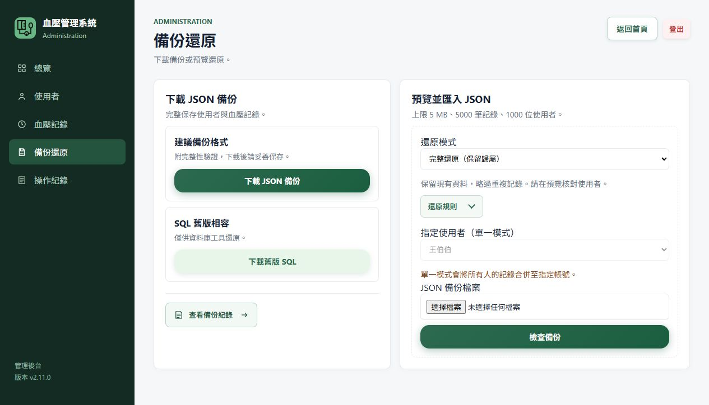

# 血壓記錄系統

> 專為家庭與長輩設計的多使用者血壓記錄網站，支援月曆、趨勢統計、Excel 匯出、管理後台及 Docker 部署。

## 目錄

- [功能特色](#功能特色)
- [快速開始](#快速開始)
- [環境變數](#環境變數)
- [管理後台與備份](#管理後台與備份)
- [健康檢查](#健康檢查)
- [畫面截圖](#畫面截圖)
- [既有資料庫升級](#既有資料庫升級)
- [本機開發](#本機開發)
- [CI/CD](#cicd)
- [版本紀錄](#版本紀錄)

## 功能特色

- **多使用者 Portal**：家庭成員各自保存記錄，透過大頭貼快速切換。
- **長者友善輸入流程**：四步驟完成血壓記錄，支援上午、下午及補錄時段。
- **月曆與單日詳情**：以早／晚狀態顯示每月記錄，並可查看或修改單日資料。
- **趨勢與健康摘要**：統計收縮壓、舒張壓與心跳變化，圖表支援放大檢視。
- **清晰的血壓分級**：以綠、藍、紅色區分正常、低血壓及高血壓。
- **匯出與備份**：支援 Excel 匯出，以及附 SHA-256 checksum 的版本化 JSON 備份。
- **管理後台**：記錄編輯、批次刪除預覽、操作稽核、近期警示與手機卡片。
- **自動資料庫升級**：啟動時檢查 migration，僅套用未完成項目。
- **PWA 與 Docker**：可安裝至手機主畫面，並支援 GHCR image、Docker Compose 及外部 MariaDB。

## 快速開始

### Docker（推薦）

首次安裝：建立 MariaDB 資料庫，匯入 [mariadb/init.sql](mariadb/init.sql)，再建立 <code>compose.yml</code>。資料庫帳號須具備正常讀寫及 `CREATE`、`ALTER`、`INDEX`、`REFERENCES` 權限，供啟動時升級使用。

~~~yaml
services:
  app:
    image: ghcr.io/shamough1792/blood_pressure_tracker:2.11.0
    ports:
      - "3000:3000"
    environment:
      TZ: Asia/Hong_Kong
      DB_HOST: 192.168.1.222
      DB_USER: tracker_user
      DB_PASSWORD: your_database_password
      DB_NAME: blood_test
      ADMIN_USER: admin
      ADMIN_PASSWORD: your_admin_password
      SESSION_SECRET: your_random_session_secret
    restart: unless-stopped
~~~

啟動服務：

~~~bash
docker compose up -d
~~~

開啟：

- 使用者入口：<http://localhost:3000>
- 管理後台：<http://localhost:3000/admin>

> 正式環境建議固定使用完整版本標籤（例如 <code>2.11.0</code>），確認升級後再更新；<code>latest</code> 會隨最新正式版移動。

### 從原始碼建置 Docker image

~~~bash
git clone https://github.com/shamough1792/Blood_Pressure_Tracker.git
cd Blood_Pressure_Tracker
docker compose up -d --build
~~~

啟動前請在 [docker-compose.yml](docker-compose.yml) 填入資料庫及管理員環境變數。

## 環境變數

| 變數 | 必填 | 說明 | 預設值 |
| --- | :---: | --- | --- |
| <code>DB_HOST</code> | 是 | MariaDB 主機名稱或 IP | — |
| <code>DB_USER</code> | 是 | MariaDB 使用者 | — |
| <code>DB_PASSWORD</code> | 是 | MariaDB 密碼 | — |
| <code>DB_NAME</code> | 是 | 資料庫名稱 | — |
| <code>DB_POOL_SIZE</code> | 否 | 資料庫連線池上限 | <code>10</code> |
| <code>PORT</code> | 否 | Web 服務埠號 | <code>3000</code> |
| <code>ADMIN_USER</code> | 是 | 管理後台帳號 | — |
| <code>ADMIN_PASSWORD</code> | 是 | 管理後台密碼 | — |
| <code>SESSION_SECRET</code> | 是 | Session cookie 簽名密鑰 | — |
| <code>TZ</code> | 否 | 伺服器時區 | 依執行環境 |

產生高熵 <code>SESSION_SECRET</code>：

~~~bash
node -e "console.log(require('crypto').randomBytes(32).toString('base64url'))"
~~~

若 <code>ADMIN_USER</code>、<code>ADMIN_PASSWORD</code> 或 <code>SESSION_SECRET</code> 未設定，服務會拒絕啟動。
Production 環境亦必須提供 <code>DB_HOST</code>、<code>DB_USER</code>、<code>DB_PASSWORD</code> 與 <code>DB_NAME</code>；不再使用內建資料庫預設值。

## 管理後台與備份

登入 `/admin` 後可使用：

| 頁面 | 功能 |
| --- | --- |
| 總覽 | 今日／近 7 日統計、異常量測、未量測提醒 |
| 使用者 | 搜尋、新增、編輯姓名與識別色、刪除 |
| 血壓記錄 | 條件篩選、日期快捷、排序、單筆編輯／刪除、批次刪除預覽 |
| 備份還原 | JSON 備份、使用者對應預覽、重複資料略過、舊版 SQL 下載 |
| 操作紀錄 | 修改前後資料、操作原因、備份歷史、資料品質與外部備份回報 |

記錄編輯／刪除須填寫原因；批次刪除限本頁最多 100 筆，先核對明細，若確認時資料已變更則拒絕操作。篩選、分頁與 CSV 匯出使用相同條件，CSV 每次最多 10,000 筆。

### JSON 備份與還原

| 模式 | 處理方式 |
| --- | --- |
| 完整還原 | 完全同名帳號對應現有使用者，缺少者新增。請核對同名者是否為同一人；目的資料庫有重複姓名時拒絕還原。 |
| 匯入至單一使用者 | 所有有效記錄歸入指定帳號，不保留原使用者歸屬。 |

- 保留現有資料，略過使用者、量測時間（同秒）、血壓與心跳皆相同的記錄。
- 單檔最多 5 MB、5000 筆記錄、1000 位使用者；較大資料請用資料庫備份工具還原。
- SHA-256 checksum 檢查內容一致性，不代表來源可信；請勿直接修改備份檔案。
- JSON 只包含使用者及量測資料；稽核與備份歷史須另以資料庫備份保存。
- 匯出紀錄不代表檔案已下載保存；刪除沒有介面復原功能。

### 外部資料庫備份

在操作紀錄頁登記來源、完成時間、結果、檔案識別、選填 checksum 與備註。成功須有檔案或工作識別，失敗須有原因。這是管理員人工回報，不會執行外部備份或驗證可還原性；未回報時顯示狀態未知。

### 部署安全建議

- 使用 HTTPS reverse proxy 提供外部存取。
- 不要直接將應用程式的 <code>3000</code> port 暴露至公網。
- 定期備份資料庫或下載 JSON 備份。
- Session cookie 使用 <code>HttpOnly</code> 與 <code>SameSite=Lax</code>；HTTPS 請求會加上 <code>Secure</code>。

## 健康檢查

| 端點 | 用途 | 成功狀態 |
| --- | --- | :---: |
| <code>GET /health</code> | 確認 Node.js 程序正在運行 | <code>200</code> |
| <code>GET /ready</code> | 確認應用程式可連線至資料庫 | <code>200</code> |

資料庫不可用時 <code>/ready</code> 會回傳 <code>503</code>。官方 Docker image 已內建 <code>HEALTHCHECK</code>。

## 畫面截圖

| 使用者入口 | 記錄首頁 |
| --- | --- |
|  |  |

| 月曆記錄 | 單日詳細記錄 |
| --- | --- |
|  |  |

| 統計頁 | 管理後台 |
| --- | --- |
|  |  |

備份還原（2.11.0，示範資料）

管理員登入頁

## 既有資料庫升級

**2.11.0 起自動升級，不必逐個手動匯入 migration。**

1. 備份資料庫並停止舊服務寫入。
2. 將 Compose 的 image 改為 `ghcr.io/shamough1792/blood_pressure_tracker:2.11.0`。
3. 拉取並啟動新版：

~~~bash
docker compose pull
docker compose up -d
docker compose logs -f app
~~~

看到「資料庫升級檢查完成」後才會開放 HTTP 服務。從原始碼啟動的 `npm start` 亦會執行相同檢查。

- 帳號需有讀寫、`CREATE`、`ALTER`、`INDEX`、`REFERENCES` 權限；不要以 root 執行正式服務。
- 已手動套用的 003／004 可安全納入升級歷史。舊版 001／002 會檢查並補齊欄位、外鍵及索引。
- 多個服務共用升級鎖，最多等候 30 秒；逾時可稍後重啟。
- 升級失敗會停止啟動，請依日誌修正權限或資料歸屬。DDL 可能已部分提交，不保證自動回復。

開發者：新增 migration 與升級歷史

將新 SQL 放在 `mariadb/migration-NNN-*.sql`，使用遞增編號，例如 `migration-005-example.sql`。啟動時依檔名排序執行，完成後在 `schema_migrations` 保存檔名、checksum 與時間。

已完成的檔案不可修改或重新命名，變更請新增 migration。SQL 須可安全重試；支援一般字串與註解內分號，不支援 `DELIMITER`、程序／trigger 腳本。既有記錄缺少對應使用者時會停止升級，不會刪除資料。

## 本機開發

### 系統需求

- Node.js 20 或以上
- MariaDB 10.6 或以上

### 安裝與啟動

~~~bash
npm install
npm start
~~~

### 執行測試

~~~bash
npm test
~~~

專案使用 Node.js 內建 test runner，測試涵蓋認證、記錄存取、備份、分頁、管理後台及主要 UI 行為。

另有可選的真實 MariaDB 測試：啟動獨立的本機 MariaDB 10.11 暫存容器，建立空白 `bp_admin_test` 資料庫及無密碼 root 測試帳號，將動態映射的埠設為 `BP_ADMIN_TEST_PORT`，執行 `node --test test/adminMariaDb.test.js`。測試會新增資料與 trigger，僅限可拋棄的測試資料庫；未設定該變數時，預設測試會略過此項。測試不讀取 `.env`，不使用 `DB_*` 連線設定。

## CI/CD

- Pull Request 與 <code>main</code> push 會執行語法檢查、測試、production dependency audit 及 Docker build。
- 推送 <code>vX.Y.Z</code> tag 時，Release workflow 會核對 tag 與 <code>package.json</code> 版本。
- 通過後自動建立 GitHub Release，並發布完整版本及 <code>latest</code> 標籤至 GHCR。

## 版本紀錄

| 版本 | 重點更新 |
| --- | --- |
| [2.11.0](https://github.com/shamough1792/Blood_Pressure_Tracker/releases/tag/v2.11.0) | 後台記錄管理、完整備份還原、操作稽核、自動資料庫升級及介面精簡 |
| [2.10.1](https://github.com/shamough1792/Blood_Pressure_Tracker/releases/tag/v2.10.1) | 修正 MariaDB 月份別名造成查看紀錄頁無法開啟的問題 |
| [2.10.0](https://github.com/shamough1792/Blood_Pressure_Tracker/releases/tag/v2.10.0) | 後台警告與手機版體驗改善、移除資料庫預設憑證、CSV 串流限量匯出、Portal SQL 聚合查詢 |
| [2.9.0](https://github.com/shamough1792/Blood_Pressure_Tracker/releases/tag/v2.9.0) | 管理後台可靠性與安全、JSON 備份、健康檢查、近期統計及 CI/CD |
| [2.8.7](https://github.com/shamough1792/Blood_Pressure_Tracker/releases/tag/v2.8.7) | 管理後台篩選、分頁與操作體驗 |
| [2.8.6](https://github.com/shamough1792/Blood_Pressure_Tracker/releases/tag/v2.8.6) | 今日記錄改以伺服器日期計算 |
| [2.8.5](https://github.com/shamough1792/Blood_Pressure_Tracker/releases/tag/v2.8.5) | 管理員登入頁版面優化 |
| [2.8.3](https://github.com/shamough1792/Blood_Pressure_Tracker/releases/tag/v2.8.3) | 首頁、手機版、月曆及補錄流程優化 |

更早版本與完整變更請參閱 [GitHub Releases](https://github.com/shamough1792/Blood_Pressure_Tracker/releases)。

## 授權

本專案採用 [MIT License](LICENSE.md)。
