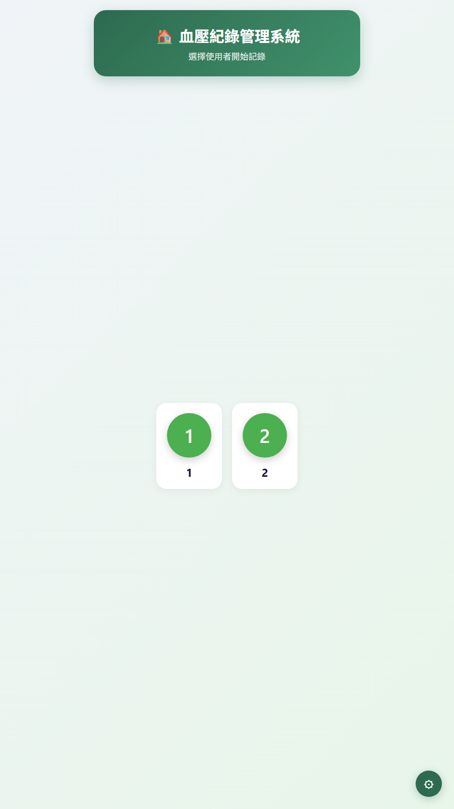
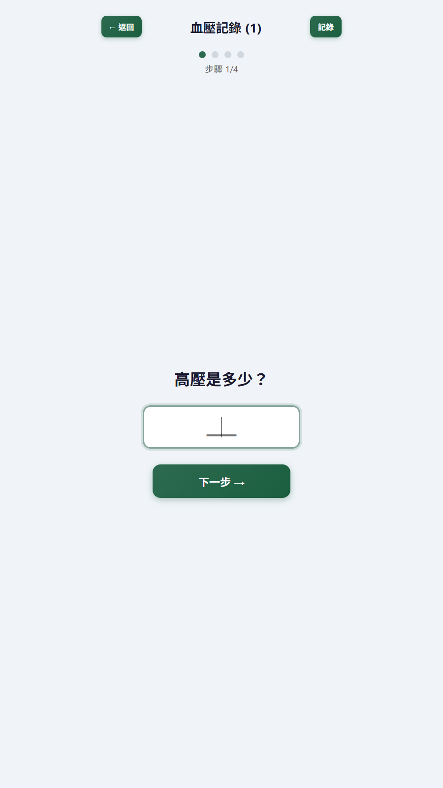
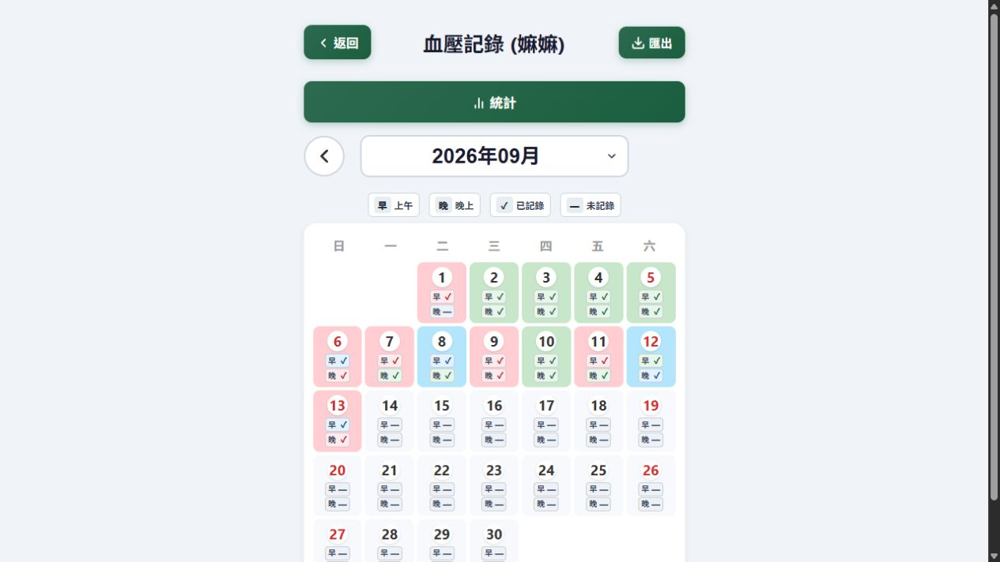
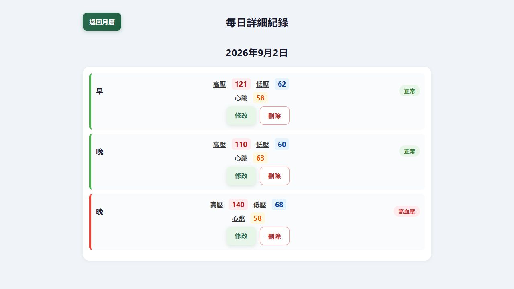
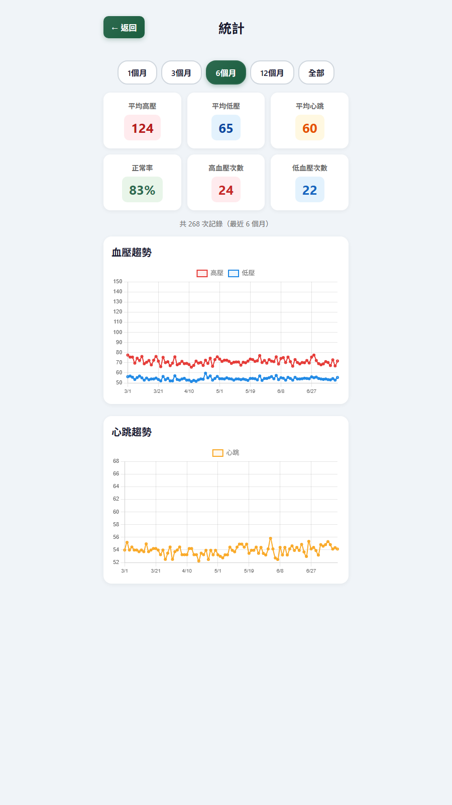
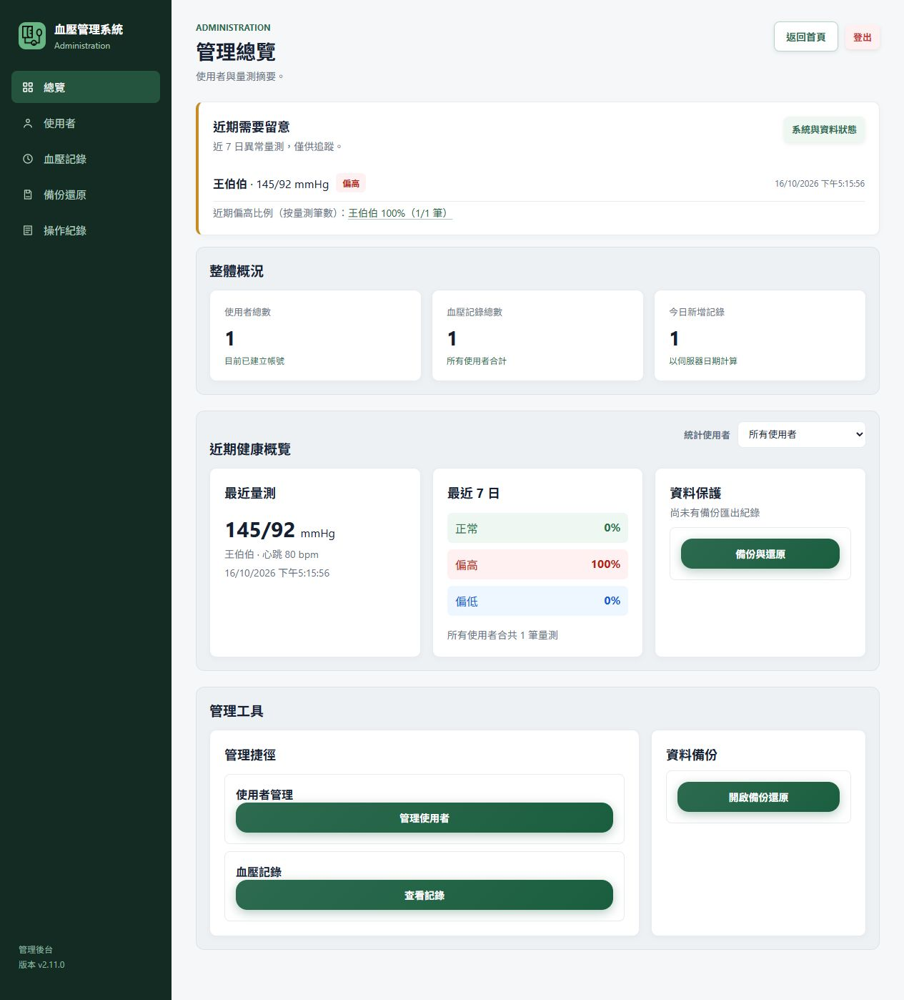
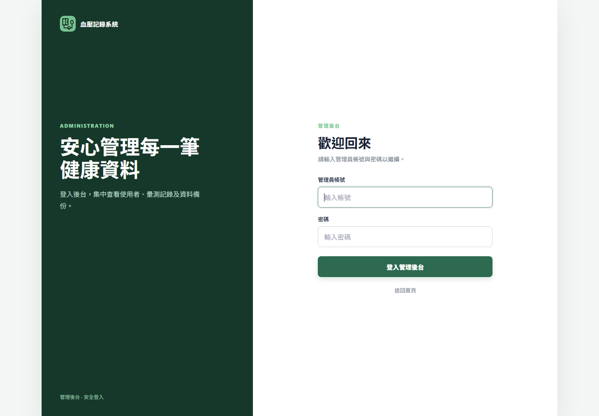

# 血壓記錄系統

> 專為家庭與長輩設計的多使用者血壓記錄網站，支援月曆、趨勢統計、Excel 匯出、管理後台及 Docker 部署。

## 目錄

- [功能特色](#功能特色)
- [快速開始](#快速開始)
- [環境變數](#環境變數)
- [管理後台與備份](#管理後台與備份)
- [健康檢查](#健康檢查)
- [畫面截圖](#畫面截圖)
- [既有資料庫升級](#既有資料庫升級)
- [本機開發](#本機開發)
- [版本紀錄](#版本紀錄)

## 功能特色

- **多使用者 Portal**：家庭成員各自保存記錄，透過大頭貼快速切換。
- **長者友善輸入流程**：四步驟完成血壓記錄，支援上午、下午及補錄時段。
- **月曆與單日詳情**：以早／晚狀態顯示每月記錄，並可查看或修改單日資料。
- **趨勢與健康摘要**：統計收縮壓、舒張壓與心跳變化，圖表支援放大檢視。
- **清晰的血壓分級**：以綠、藍、紅色區分正常、低血壓及高血壓。
- **匯出與備份**：支援 Excel 匯出，以及附 SHA-256 checksum 的版本化 JSON 備份。
- **管理後台**：管理使用者與記錄、進階篩選、近期統計及系統狀態。
- **PWA 與 Docker**：可安裝至手機主畫面，並支援 GHCR image、Docker Compose 及外部 MariaDB。

## 快速開始

### Docker（推薦）

先準備可連線的 MariaDB 資料庫，並匯入 [mariadb/init.sql](mariadb/init.sql)。接著建立 <code>compose.yml</code>：

~~~yaml
services:
  app:
    image: ghcr.io/shamough1792/blood_pressure_tracker:2.11.0
    ports:
      - "3000:3000"
    environment:
      TZ: Asia/Hong_Kong
      DB_HOST: 192.168.1.222
      DB_USER: tracker_user
      DB_PASSWORD: your_database_password
      DB_NAME: blood_test
      ADMIN_USER: admin
      ADMIN_PASSWORD: your_admin_password
      SESSION_SECRET: your_random_session_secret
    restart: unless-stopped
~~~

啟動服務：

~~~bash
docker compose up -d
~~~

開啟：

- 使用者入口：<http://localhost:3000>
- 管理後台：<http://localhost:3000/admin>

> 正式環境建議固定使用完整版本標籤（例如 <code>2.11.0</code>），確認升級後再更新；<code>latest</code> 會隨最新正式版移動。

### 從原始碼建置 Docker image

~~~bash
git clone https://github.com/shamough1792/Blood_Pressure_Tracker.git
cd Blood_Pressure_Tracker
docker compose up -d --build
~~~

啟動前請在 [docker-compose.yml](docker-compose.yml) 填入資料庫及管理員環境變數。

## 環境變數

| 變數 | 必填 | 說明 | 預設值 |
| --- | :---: | --- | --- |
| <code>DB_HOST</code> | 是 | MariaDB 主機名稱或 IP | — |
| <code>DB_USER</code> | 是 | MariaDB 使用者 | — |
| <code>DB_PASSWORD</code> | 是 | MariaDB 密碼 | — |
| <code>DB_NAME</code> | 是 | 資料庫名稱 | — |
| <code>DB_POOL_SIZE</code> | 否 | 資料庫連線池上限 | <code>10</code> |
| <code>PORT</code> | 否 | Web 服務埠號 | <code>3000</code> |
| <code>ADMIN_USER</code> | 是 | 管理後台帳號 | — |
| <code>ADMIN_PASSWORD</code> | 是 | 管理後台密碼 | — |
| <code>SESSION_SECRET</code> | 是 | Session cookie 簽名密鑰 | — |
| <code>TZ</code> | 否 | 伺服器時區 | 依執行環境 |

產生高熵 <code>SESSION_SECRET</code>：

~~~bash
node -e "console.log(require('crypto').randomBytes(32).toString('base64url'))"
~~~

若 <code>ADMIN_USER</code>、<code>ADMIN_PASSWORD</code> 或 <code>SESSION_SECRET</code> 未設定，服務會拒絕啟動。
Production 環境亦必須提供 <code>DB_HOST</code>、<code>DB_USER</code>、<code>DB_PASSWORD</code> 與 <code>DB_NAME</code>；不再使用內建資料庫預設值。

## 管理後台與備份

管理後台位於 <code>/admin</code>，登入後可：

- 管理使用者及血壓記錄。
- 依使用者、日期及血壓條件篩選記錄。
- 以串流方式匯出 CSV，每次最多 10,000 筆。
- 查看以伺服器日期計算的今日記錄與指定使用者最近 7 日統計。
- 下載 JSON 或舊版 SQL 備份。
- 預覽 JSON 匯入結果，再以資料庫交易寫入。

JSON 是目前建議的備份格式，檔案包含格式版本與 SHA-256 checksum。匯入時會先顯示有效、略過及總筆數，確認後才寫入資料庫。

### 新版管理功能（2.11.0）

- 記錄篩選由伺服器統一處理；提供今天、最近 7／30 日及本月快捷範圍，匯出沿用目前條件。
- 記錄支援單筆編輯、單筆刪除與本頁批次刪除（最多 100 筆）；編輯／刪除須填寫原因。編輯會檢查畫面資料是否已被其他操作修改。
- 總覽列出近期偏高／偏低記錄及超過 7 日未量測的使用者，可直接前往記錄頁。
- `/admin/activity` 提供操作紀錄、資料完整性檢查及最近 10 次備份匯出紀錄。資料變更與成功稽核在同一交易內完成，失敗時一起回復；失敗稽核若因資料庫不可用而無法保存，會記錄至伺服器日誌。
- 稽核內容包含修改前後資料、刪除資料及原因，僅管理員可見。其用途是追蹤操作，並非介面上的垃圾桶／復原功能。JSON 備份只包含使用者與量測資料，不包含稽核或備份歷史；這些歷史須以資料庫備份保存。
- 備份紀錄代表伺服器已產生匯出，不保證用戶端已完成下載或保存。SHA-256 checksum 用於檢查檔案內容一致性，不是來源簽章。

JSON 還原提供兩種模式：

| 模式 | 使用者與記錄處理 |
| --- | --- |
| 完整還原 | 依完全相同的姓名對應現有帳號，缺少者新增；不使用來源 ID 覆寫現有帳號。若目的資料庫有重複姓名，會拒絕曖昧對應。請在預覽中確認同名者確為同一人。 |
| 匯入至指定使用者 | 備份內所有有效記錄都歸入選定帳號，來源使用者歸屬不保留。 |

兩種模式皆保留現有資料，略過同使用者、同秒量測時間、相同血壓與心跳的記錄。預覽顯示新增、無效與重複筆數及使用者對應；確認時會重新檢查，結果可能因其他操作而改變。單檔上限 5 MB、5000 筆記錄、1000 位使用者；較大的 JSON 匯出檔請改用資料庫備份工具還原，勿直接編輯含 checksum 的檔案。SQL 下載僅作舊版工具相容，建議使用 JSON 流程。

### 部署安全建議

- 使用 HTTPS reverse proxy 提供外部存取。
- 不要直接將應用程式的 <code>3000</code> port 暴露至公網。
- 定期備份資料庫或下載 JSON 備份。
- Session cookie 使用 <code>HttpOnly</code> 與 <code>SameSite=Lax</code>；production 模式會加上 <code>Secure</code>。

## 健康檢查

| 端點 | 用途 | 成功狀態 |
| --- | --- | :---: |
| <code>GET /health</code> | 確認 Node.js 程序正在運行 | <code>200</code> |
| <code>GET /ready</code> | 確認應用程式可連線至資料庫 | <code>200</code> |

資料庫不可用時 <code>/ready</code> 會回傳 <code>503</code>。官方 Docker image 已內建 <code>HEALTHCHECK</code>。

## 畫面截圖

| 使用者入口 | 記錄首頁 |
| --- | --- |
|  |  |

| 月曆記錄 | 單日詳細記錄 |
| --- | --- |
|  |  |

| 統計頁 | 管理後台 |
| --- | --- |
|  |  |

管理員登入頁

## 既有資料庫升級

本版本在 `npm start`／Docker 啟動時會自動檢查並依檔名順序執行 `mariadb/migration-NNN-*.sql`，完成後才開放 HTTP 服務。資料庫須已存在，首次安裝仍先匯入 `mariadb/init.sql`。

- `schema_migrations` 記錄已完成檔案、SHA-256 checksum 與時間；重啟只執行尚未完成的項目。
- 使用資料庫鎖避免多個服務同時升級，最多等待 30 秒，取不到鎖會停止啟動，可稍後重啟。
- 舊版 001／002 會先檢查欄位、外鍵與索引，只補缺少結構，避免重複新增預設使用者或索引。如果既有量測沒有對應使用者，會停止並要求修正歸屬，不會自動刪除資料。已手動套用的 003／004 使用 `CREATE TABLE IF NOT EXISTS`，可安全納入歷史。
- 應用程式的資料庫帳號須有建立資料表與修改結構權限（`CREATE`、`ALTER`、`INDEX`），以及正常讀寫權限。不要使用 root 作為正式應用程式帳號。
- 已執行的 migration 檔案不可再修改或重新命名；後續變更請新增遞增編號，例如 `migration-005-example.sql`。檔案須可安全重試；一般 SQL 支援字串／註解內分號，不支援 `DELIMITER` 或程序／trigger 腳本。
- MariaDB DDL 可能自動提交，升級失敗時不宣稱已回復；不記錄完成、不開放服務，修正問題後再重啟。更新前仍須備份並暫停其他舊版服務寫入。

需要預先手動套用時，也可執行以下 SQL：

~~~bash
mysql -h <DB_HOST> -u <DB_USER> -p <DB_NAME> < mariadb/migration-003-admin-management.sql
mysql -h <DB_HOST> -u <DB_USER> -p <DB_NAME> < mariadb/migration-004-database-backup-reports.sql
~~~

新安裝的 `mariadb/init.sql` 已包含所需資料表。若需回復程式版本，可保留新增資料表，舊版不會使用它們。

批次刪除會先向伺服器取得所選記錄的使用者、時間、血壓及心跳明細，確認時再次核對資料指紋；若記錄已變更則拒絕刪除，須重新預覽。手機卡片的編輯／刪除按鈕位於右上角，桌面量測時間欄提供排序連結與對應的 `aria-sort`。

系統狀態頁另提供「外部資料庫備份狀態」及管理員回報表單，可登記備份來源、工作完成時間、成功／失敗、檔案或工作識別、選填 SHA-256 及備註。成功結果須有檔案或工作識別，失敗結果須有原因；會同時保存回報者與登記時間，分別顯示最近工作結果及最近成功時間。這是人工回報功能，不會執行外部備份、查驗外部檔案或證明可還原性；未回報時明示狀態未知，與 JSON／SQL 匯出紀錄分開。外部排程可由管理員查看其實際執行結果後登記，請勿填寫憑證。

升級前請先備份資料庫。從早於 <code>2.9.0</code> 的版本升級時，請確認已套用記錄查詢索引：

~~~bash
mysql -h <DB_HOST> -u <DB_USER> -p <DB_NAME> < mariadb/migration-002-add-record-indexes.sql
~~~

若資料庫尚未加入多使用者結構，請先檢查並套用 [mariadb/migration-001-add-users.sql](mariadb/migration-001-add-users.sql)。

## 本機開發

### 系統需求

- Node.js 20 或以上
- MariaDB 10.6 或以上

### 安裝與啟動

~~~bash
npm install
npm start
~~~

### 執行測試

~~~bash
npm test
~~~

專案使用 Node.js 內建 test runner，測試涵蓋認證、記錄存取、備份、分頁、管理後台及主要 UI 行為。

另有可選的真實 MariaDB 測試：啟動獨立的本機 MariaDB 10.11 暫存容器，建立空白 `bp_admin_test` 資料庫及無密碼 root 測試帳號，將動態映射的埠設為 `BP_ADMIN_TEST_PORT`，執行 `node --test test/adminMariaDb.test.js`。測試會新增資料與 trigger，僅限可拋棄的測試資料庫；未設定該變數時，預設測試會略過此項。測試不讀取 `.env`，不使用 `DB_*` 連線設定。

## CI/CD

- Pull Request 與 <code>main</code> push 會執行語法檢查、測試、production dependency audit 及 Docker build。
- 推送 <code>vX.Y.Z</code> tag 時，Release workflow 會核對 tag 與 <code>package.json</code> 版本。
- 通過後自動建立 GitHub Release，並發布完整版本及 <code>latest</code> 標籤至 GHCR。

## 版本紀錄

| 版本 | 重點更新 |
| --- | --- |
| [2.11.0](https://github.com/shamough1792/Blood_Pressure_Tracker/releases/tag/v2.11.0) | 後台記錄管理、完整備份還原、操作稽核、自動資料庫升級及介面精簡 |
| [2.10.1](https://github.com/shamough1792/Blood_Pressure_Tracker/releases/tag/v2.10.1) | 修正 MariaDB 月份別名造成查看紀錄頁無法開啟的問題 |
| [2.10.0](https://github.com/shamough1792/Blood_Pressure_Tracker/releases/tag/v2.10.0) | 後台警告與手機版體驗改善、移除資料庫預設憑證、CSV 串流限量匯出、Portal SQL 聚合查詢 |
| [2.9.0](https://github.com/shamough1792/Blood_Pressure_Tracker/releases/tag/v2.9.0) | 管理後台可靠性與安全、JSON 備份、健康檢查、近期統計及 CI/CD |
| [2.8.7](https://github.com/shamough1792/Blood_Pressure_Tracker/releases/tag/v2.8.7) | 管理後台篩選、分頁與操作體驗 |
| [2.8.6](https://github.com/shamough1792/Blood_Pressure_Tracker/releases/tag/v2.8.6) | 今日記錄改以伺服器日期計算 |
| [2.8.5](https://github.com/shamough1792/Blood_Pressure_Tracker/releases/tag/v2.8.5) | 管理員登入頁版面優化 |
| [2.8.3](https://github.com/shamough1792/Blood_Pressure_Tracker/releases/tag/v2.8.3) | 首頁、手機版、月曆及補錄流程優化 |

更早版本與完整變更請參閱 [GitHub Releases](https://github.com/shamough1792/Blood_Pressure_Tracker/releases)。

## 授權

本專案採用 [MIT License](LICENSE.md)。
